# Andalusia Academy — Entity Relationship Diagram

Generated from `Andalusia.Persistance/Migrations/AppDbContextModelSnapshot.cs` (the EF Core model snapshot), so it
matches the current database schema: 41 tables, 62 foreign-key relationships.

Reading guide: `A ||--o{ B` means one `A` has many `B`; `A |o--o{ B` means the foreign key on `B` is optional.
The label on each line is the foreign-key column on the child table.

Render it with any Mermaid viewer (GitHub renders it inline), or paste the block into https://mermaid.live.

After adding a migration, regenerate the diagram from the updated snapshot so this file stays in sync.

```mermaid
erDiagram
    Application {
        bigint ApplicationId PK
        bigint CourseId FK
        bigint ProgramId FK
        bigint ScheduleId FK
        string Status
        datetime SubmissionDate
        bigint UserId FK
    }
    Assignment {
        bigint AssignmentId PK
        string Description
        datetime DueDate
        int MaxScore
        bigint ScheduleId FK
        string Title
    }
    AssignmentSubmission {
        bigint SubmissionId PK
        bigint AssignmentId FK
        int AttemptNumber
        string Feedback
        string FileUrl
        datetime GradedAt
        bigint GradedBy
        bigint LearnerId FK
        int Score
        string Status
        datetime SubmittedAt
    }
    Attendance {
        bigint AttendanceId PK
        bigint LearnerId FK
        datetime MarkedAt
        bigint SessionId FK
        string Status
    }
    CareerPath {
        bigint CareerPathId PK
        string LearningJourney
        string Overview
        string RecommendedSkills
        string Slug
        string Status
        string Title
    }
    Category {
        bigint CategoryId PK
        bool IsTrending
        string Name
        string Slug
    }
    ContactEnquiry {
        bigint EnquiryId PK
        datetime CreatedAt
        string Email
        string FullName
        bigint HandledBy FK
        string Message
        string MobileNumber
        string Status
        string SubjectType
        bigint UserId FK
    }
    ContentPage {
        bigint PageId PK
        string ContentPayload
        string PageKey
        string SectionKey
        datetime UpdatedAt
        bigint UpdatedBy FK
    }
    Course {
        bigint CourseId PK
        string Accreditation
        bigint CareerPathId FK
        string Category
        bigint CategoryId
        string DeliveryMode
        string Description
        string DurationLabel
        string Hall
        bool IsFeatured
        string Level
        bigint MentorId FK
        bigint ProgramId FK
        string Slug
        string SyllabusPath
        string Title
        decimal Tuition
        string TuitionNote
    }
    CourseApplication {
        bigint Id PK
        bigint CourseId FK
        datetime CreatedAt
        string Email
        string FullName
        string Message
        string Phone
        int Status
        bigint UserId FK
    }
    CourseBullet {
        bigint Id PK
        bigint CourseId FK
        string Text
    }
    CourseCohort {
        bigint Id PK
        int Capacity
        bigint CourseId FK
        int EnrolledCount
        date StartDate
        int Status
    }
    CourseMaterial {
        bigint MaterialId PK
        bigint CourseId FK
        string FileUrl
        string ResourceType
        bigint ScheduleId FK
        string Title
        datetime UploadedAt
    }
    DirectMessage {
        bigint DirectMessageId PK
        string Body
        datetime ReadAt
        bigint RecipientId FK
        bigint SenderId FK
        datetime SentAt
    }
    EmailVerificationToken {
        bigint VerificationId PK
        datetime CreatedAt
        datetime ExpiresAt
        string Token
        bigint UserId FK
        datetime VerifiedAt
    }
    Enrollment {
        bigint EnrollmentId PK
        bigint ApplicationId FK
        bigint CourseId FK
        datetime EnrolledAt
        bigint ProgramId FK
        bigint ScheduleId FK
        string Status
        bigint UserId FK
    }
    EnrollmentAudit {
        bigint EnrollmentAuditId PK
        string Action
        bigint ActorUserId
        bigint EnrollmentId
        string NewStatus
        datetime PerformedAtUtc
        string PreviousStatus
        string Reason
    }
    Faq {
        bigint FaqId PK
        string Answer
        bigint CategoryId FK
        bool IsActive
        int OrderIndex
        string Question
    }
    Instructor {
        bigint InstructorId PK,FK
        string AvatarUrl
        string Bio
        string JobTitle
    }
    InstructorPayout {
        bigint PayoutId PK
        decimal Amount
        datetime CreatedAt
        string Currency
        bigint InstructorId FK
        string Notes
        datetime PaidAt
        bigint ProcessedBy FK
        bigint ScheduleId FK
        string Status
    }
    LearningOutcome {
        bigint Id PK
        bigint CourseId FK
        int Order
        string Text
        string Title
    }
    Mentor {
        bigint Id PK
        string Bio
        string Name
        string Title
    }
    Notification {
        bigint NotificationId PK
        datetime CreatedAt
        bool IsRead
        string Message
        string Title
        string Type
        bigint UserId FK
    }
    Partner {
        bigint PartnerId PK
        bool IsActive
        string LogoUrl
        string Name
        string Type
    }
    PasswordResetToken {
        bigint ResetId PK
        datetime CreatedAt
        datetime ExpiresAt
        string Token
        datetime UsedAt
        bigint UserId FK
    }
    Payment {
        bigint PaymentId PK
        decimal Amount
        bigint ApplicationId FK
        string Currency
        bigint EnrollmentId FK
        string GatewayName
        datetime PaidAt
        string Status
        string TransactionRef
        bigint UserId FK
    }
    Permission {
        int PermissionId PK
        string Code
        string Description
    }
    Program {
        bigint ProgramId PK
        bigint CareerPathId FK
        bigint CategoryId FK
        string Duration
        string Overview
        decimal Price
        string Requirements
        string Slug
        string Status
        string Structure
        string Title
    }
    ProgramCourse {
        bigint ProgramId PK,FK
        bigint CourseId PK,FK
        int OrderIndex
    }
    ProgramPartner {
        bigint ProgramId PK,FK
        bigint PartnerId PK,FK
        string AccreditationDetails
    }
    Progress {
        bigint ProgressId PK
        int CompletedSessionsCount
        bigint EnrollmentId FK
        datetime LastUpdatedAt
        decimal ProgressPercentage
        int SubmittedAssignmentsCount
    }
    RelatedCourse {
        bigint CourseId PK,FK
        bigint RelatedCourseId PK,FK
    }
    RelatedProgram {
        bigint ProgramId PK,FK
        bigint RelatedProgramId PK,FK
    }
    Role {
        int RoleId PK
        string Name
    }
    RolePermission {
        int RoleId PK,FK
        int PermissionId PK,FK
    }
    Schedule {
        bigint ScheduleId PK
        string BatchCode
        int Capacity
        bigint CourseId FK
        date EndDate
        bigint ProgramId FK
        string RoomNumber
        date StartDate
        string Status
        string VenueName
    }
    ScheduleInstructor {
        bigint ScheduleId PK,FK
        bigint InstructorId PK,FK
    }
    Session {
        bigint SessionId PK
        time EndTime
        string RoomDetails
        bigint ScheduleId FK
        date SessionDate
        time StartTime
        string Title
    }
    Testimonial {
        bigint TestimonialId PK
        string AvatarUrl
        string ClientName
        bigint CourseId FK
        bool IsFeatured
        string QuoteText
        int Rating
        string TitleOrRole
        bigint UserId FK
    }
    User {
        bigint UserId PK
        string Country
        datetime CreatedAt
        string Email
        string FirstName
        bool IsActive
        bool IsEmailVerified
        string LastName
        string MobileNumber
        string PasswordHash
        string PreferredLanguage
        datetime TermsAcceptedAt
    }
    UserRole {
        bigint UserId PK,FK
        int RoleId PK,FK
    }
    Course ||--o{ CourseApplication : "CourseId"
    User |o--o{ CourseApplication : "UserId"
    Course ||--o{ CourseBullet : "CourseId"
    Course ||--o{ CourseCohort : "CourseId"
    Course ||--o{ LearningOutcome : "CourseId"
    Course |o--o{ Application : "CourseId"
    Program |o--o{ Application : "ProgramId"
    Schedule |o--o{ Application : "ScheduleId"
    User ||--o{ Application : "UserId"
    Schedule ||--o{ Assignment : "ScheduleId"
    Assignment ||--o{ AssignmentSubmission : "AssignmentId"
    User ||--o{ AssignmentSubmission : "LearnerId"
    User ||--o{ Attendance : "LearnerId"
    Session ||--o{ Attendance : "SessionId"
    User |o--o{ ContactEnquiry : "HandledBy"
    User |o--o{ ContactEnquiry : "UserId"
    User ||--o{ ContentPage : "UpdatedBy"
    CareerPath |o--o{ Course : "CareerPathId"
    Mentor ||--o{ Course : "MentorId"
    Program |o--o{ Course : "ProgramId"
    Course ||--o{ CourseMaterial : "CourseId"
    Schedule |o--o{ CourseMaterial : "ScheduleId"
    User ||--o{ DirectMessage : "RecipientId"
    User ||--o{ DirectMessage : "SenderId"
    User ||--o{ EmailVerificationToken : "UserId"
    Application |o--o{ Enrollment : "ApplicationId"
    Course |o--o{ Enrollment : "CourseId"
    Program |o--o{ Enrollment : "ProgramId"
    Schedule |o--o{ Enrollment : "ScheduleId"
    User ||--o{ Enrollment : "UserId"
    Category |o--o{ Faq : "CategoryId"
    User ||--o| Instructor : "InstructorId"
    Instructor ||--o{ InstructorPayout : "InstructorId"
    User ||--o{ InstructorPayout : "ProcessedBy"
    Schedule |o--o{ InstructorPayout : "ScheduleId"
    User ||--o{ Notification : "UserId"
    User ||--o{ PasswordResetToken : "UserId"
    Application |o--o{ Payment : "ApplicationId"
    Enrollment |o--o{ Payment : "EnrollmentId"
    User ||--o{ Payment : "UserId"
    CareerPath |o--o{ Program : "CareerPathId"
    Category ||--o{ Program : "CategoryId"
    Course ||--o{ ProgramCourse : "CourseId"
    Program ||--o{ ProgramCourse : "ProgramId"
    Partner ||--o{ ProgramPartner : "PartnerId"
    Program ||--o{ ProgramPartner : "ProgramId"
    Enrollment ||--o| Progress : "EnrollmentId"
    Course ||--o{ RelatedCourse : "CourseId"
    Course ||--o{ RelatedCourse : "RelatedCourseId"
    Program ||--o{ RelatedProgram : "ProgramId"
    Program ||--o{ RelatedProgram : "RelatedProgramId"
    Permission ||--o{ RolePermission : "PermissionId"
    Role ||--o{ RolePermission : "RoleId"
    Course |o--o{ Schedule : "CourseId"
    Program |o--o{ Schedule : "ProgramId"
    Instructor ||--o{ ScheduleInstructor : "InstructorId"
    Schedule ||--o{ ScheduleInstructor : "ScheduleId"
    Schedule ||--o{ Session : "ScheduleId"
    Course |o--o{ Testimonial : "CourseId"
    User |o--o{ Testimonial : "UserId"
    Role ||--o{ UserRole : "RoleId"
    User ||--o{ UserRole : "UserId"
```

## Domain areas

| Area | Tables |
|---|---|
| Catalog | Category, CareerPath, Program, ProgramCourse, Course, CourseCohort, Mentor, LearningOutcome, CourseBullet, RelatedCourse, RelatedProgram, Partner, ProgramPartner |
| Admissions & payments | Application, CourseApplication, Enrollment, EnrollmentAudit, Payment |
| Teaching & delivery | Schedule, ScheduleInstructor, Session, Attendance, Instructor, InstructorPayout, CourseMaterial, Assignment, AssignmentSubmission, Progress |
| Identity & access | User, Role, Permission, RolePermission, UserRole, EmailVerificationToken, PasswordResetToken |
| Communication & content | Notification, DirectMessage, ContactEnquiry, Testimonial, Faq, ContentPage |
